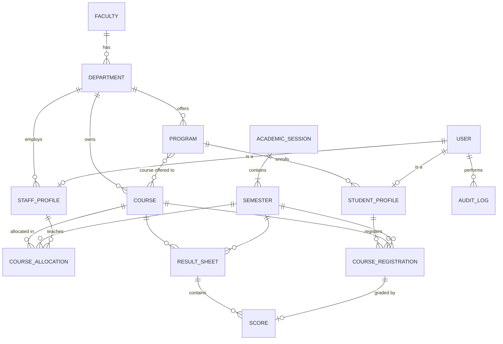

# Architecture

## 1. Overview

A single Django backend exposes a JSON API; a React single-page app consumes it.
The browser only ever talks to one origin: in development Vite proxies `/api` to Django,
and in production Vercel rewrites `/api` to the Render backend. That lets us use Django's
session cookies instead of tokens (see D2, D11).

```
Browser (React SPA)
   │  fetch /api/...  (session cookie + CSRF header)
   ▼
Django + DRF
   ├── views        thin: auth, parse, call service, serialize
   ├── permissions  role checks + object scoping
   ├── services     business rules, state transitions, audit logging
   └── models       constraints the database itself enforces
   ▼
SQLite (default) / PostgreSQL (via DATABASE_URL)
```

## 2. Stack

| Layer      | Choice                                    | Why |
|------------|-------------------------------------------|-----|
| Backend    | Django 5.2 LTS + Django REST Framework    | Mature auth, ORM, migrations, and admin out of the box. DRF gives serializers for validation and pluggable permission classes for RBAC. |
| Database   | SQLite by default, PostgreSQL supported   | Evaluators can run it with zero setup. Same ORM code runs on Postgres by setting `DATABASE_URL`. |
| Auth       | Django sessions (HttpOnly cookie) + CSRF  | See decision D2. |
| Frontend   | React + TypeScript + Vite                 | Fast dev server; types catch API-shape mistakes early. |
| Styling    | Tailwind CSS 4 + shadcn/ui, plus beUI's animated number | shadcn/ui covers the basics (table, form, dialog, sidebar); beUI adds the count-up on dashboard figures. See D12. |
| Hosting    | Vercel (frontend), Render (backend + Postgres) | Free tiers, deploy from git, and one `render.yaml` creates both the API and the database. See D11. |
| Data fetch | TanStack Query + a small fetch wrapper    | Caching, loading/error states, and refetch-after-mutation without writing a store. |
| Lint       | ruff (Python), oxlint + Prettier (TypeScript) | Fast, zero-config defaults; generated `ui/` and `motion/` folders are excluded. |
| Routing    | React Router                              | Role-based route guards and nested dashboard layouts. |
| Tests      | pytest + pytest-django                    | Focused on permissions and workflow rules. |

## 3. Backend structure

One Django app per domain. Each app owns its models, serializers, views, and `services.py`.

| App            | Owns |
|----------------|------|
| `accounts`     | `User`, `StudentProfile`, `StaffProfile`; login/logout/me; user management |
| `academics`    | `Faculty`, `Department`, `Program`, `AcademicSession`, `Semester`, `Course`, `CourseAllocation` |
| `registration` | `CourseRegistration` and the eligibility rules |
| `results`      | `ResultSheet`, `Score`, grading scale, GPA/CGPA calculation, approval state machine |
| `audit`        | `AuditLog` and a single `record()` helper |
| `reports`      | Read-only aggregate endpoints for dashboards (no models) |
| `core`         | Shared permission classes, pagination, base exception handling |

## 4. Data model



### Key models

- **User** — custom user (email login). `role`: `STUDENT | LECTURER | DEPT_ADMIN | SUPER_ADMIN`.
  `status`: `ACTIVE | SUSPENDED | DEACTIVATED`; anything other than active sets `is_active=False`.
- **StudentProfile** — `user` (1:1), `matric_number` (unique), `program`, `level` (100–500),
  plus `phone` and `address`, which are the only profile fields a student may edit.
  Department and faculty are derived through `program`, never stored twice.
- **StaffProfile** — `user` (1:1), `staff_id` (unique), `department`. Used by lecturers and
  department admins; the department here is what scopes everything they can see.
- **Program** — `department`, `name`, `code`, `duration_years` (bounds the valid levels).
- **AcademicSession** / **Semester** — `Semester(session, term=FIRST|SECOND, is_current,
  registration_open)`. A partial unique constraint guarantees at most one current semester.
- **Course** — `department` (owner), `code` (unique), `title`, `units`, `level`, `term`,
  `programs` (M2M: which programs may take it — allows shared courses like GST).
- **CourseAllocation** — `(course, semester) → lecturer`, unique per course per semester.
- **CourseRegistration** — `(student, course, semester)` with a unique constraint.
- **ResultSheet** — one per `(course, semester)`; carries the workflow `status`, submitter,
  reviewer, timestamps, and review comment.
- **Score** — `sheet`, `registration` (1:1), `ca_score`, `exam_score`, plus computed `total`,
  `grade`, `grade_point`. Scores can only exist for registered students. Scores are whole numbers;
  CA/exam may be blank while a sheet is still a draft.
- **AuditLog** — `actor`, `action`, `target_type`, `target_id`, `summary`, `details` (JSON), `created_at`.
  Append-only; no update/delete endpoints.

### Constraints enforced by the database (not just the code)

- Unique: matric number, staff ID, course code, `(student, course, semester)`,
  `(course, semester)` allocation, `(course, semester)` result sheet, `(session, term)`.
- At most one `Semester` with `is_current=True`.
- Check constraints: `ca_score ≤ 30`, `exam_score ≤ 70` (non-negative via unsigned columns),
  `1 ≤ units ≤ 6`, `1 ≤ duration_years ≤ 5` (so the highest level is 500), session `end_date > start_date`.
- Foreign keys to academic records use `PROTECT`, so a course, semester or student with
  registrations or results can't be deleted out from under them.

## 5. Permission logic

Three layers, each answering a different question:

1. **Is this role allowed to call this endpoint?** — DRF permission classes in
   `apps/core/permissions.py` (`IsStudent`, `IsLecturer`, `IsDeptAdmin`, `IsSuperAdmin`, plus
   `IsAdmin`, `IsStaff`, and `IsReadOnly` for reference data any signed-in user may read).
2. **Which records can this user see?** — every view's `get_queryset()` is filtered by scope:
   - Student → own records only
   - Lecturer → result sheets and allocations for courses allocated to them (the class list is
     part of the result sheet)
   - Dept admin → records whose department is their `StaffProfile.department`
   - Super admin → everything

   Out-of-scope objects return **404, not 403**, so the API doesn't reveal what exists.
3. **Is this action valid right now?** — service functions check business rules
   (eligibility, workflow state, "can't approve your own submission") and raise a
   validation error with a clear message. Writes into a department also call
   `ensure_department_access()`, so a department admin can't create a record in another
   department even by sending its ID.

The React app reads `role` from `/api/auth/me` and hides routes the user can't use,
but that is a convenience; removing it would not open any data.

### Endpoints and who can call them

| Endpoint | Student | Lecturer | Dept admin | Super admin |
|---|---|---|---|---|
| `POST /api/auth/login/`, `logout/`, `GET/PATCH me/` | yes | yes | yes | yes |
| `/api/student/registration/` (`available/`), `/api/student/results/` | own | – | – | – |
| `/api/faculties/`, `departments/`, `programs/`, `sessions/`, `semesters/` | read | read | read; write programs in own dept | read/write |
| `/api/courses/` | – | read own dept | read/write own dept | read/write |
| `/api/allocations/` | – | own | read/write own dept | read/write |
| `/api/result-sheets/` + `scores`, `submit` | – | own allocated courses | – | – |
| `/api/result-sheets/` + `approve`, `reject`, `reopen` | – | – | own dept | – (read only) |
| `/api/students/`, `staff/`, `registrations/`, `reports/*` | – | – | own dept | all |
| `/api/users/` (+ `status`, `role`), `/api/audit-logs/` | – | – | – | yes |

The super admin can read every result sheet but deliberately can't approve: the brief makes
approval a departmental responsibility, and keeping it there means every approval has a
reviewer from the owning department.

## 6. Key workflows

### Course registration
`registration.services.register_courses(student, course_ids)` runs in a transaction and rejects
the request unless: the current semester exists and `registration_open` is true; each course's
`programs` includes the student's program; `course.level == student.level`;
`course.term == semester.term`; the student isn't already registered (also guaranteed by the
unique constraint); and the new total stays within `MAX_UNITS_PER_SEMESTER` (24). If two requests
race past the checks, the unique constraint still stops the duplicate and the error is turned into
a normal validation message.

### Result lifecycle

```
DRAFT ──submit──▶ SUBMITTED ──approve──▶ APPROVED
                    │    ▲                  │
              reject│    │submit            │reopen
                    ▼    │                  │
                   RETURNED ◀───────────────┘
```

A sheet is created as soon as a course is allocated, so it always exists for the lecturer to open.

- Lecturer edits scores only while the sheet is `DRAFT` or `RETURNED`.
- Submit requires both scores for every registered student.
- Only a dept admin of the course's department can approve, reject or reopen; the service also
  rejects the action if `reviewer == sheet.submitted_by`. Reject and reopen need a comment,
  which the lecturer sees as feedback.
- Reopening an approved sheet is the "authorized reopening" from the brief: it moves the sheet
  back to `RETURNED`, which hides it from students again until it is re-approved.
- Every score save records each changed student's before and after values, so edits made after
  a rejection or reopening are traceable.
- Workflow actions lock the sheet row (`select_for_update`) so a save and a submit can't interleave.
- Students only ever see scores whose sheet is `APPROVED` — enforced in the queryset.

All transitions go through `_transition()` in `apps/results/services.py`, which checks an explicit
`TRANSITIONS` table, and each one writes an `AuditLog` entry. The sheet detail endpoint returns
that history alongside the scores.

## 7. Grading and GPA

Configured in `settings.GRADING_SCALE` (documented here and in the README):

| Score  | Grade | Point |
|--------|-------|-------|
| 70–100 | A     | 5     |
| 60–69  | B     | 4     |
| 50–59  | C     | 3     |
| 45–49  | D     | 2     |
| 40–44  | E     | 1     |
| 0–39   | F     | 0     |

CA is out of 30, exam out of 70 (`CA_MAX_SCORE`, `EXAM_MAX_SCORE`). The grade bands live in
`GRADING_SCALE`; the lookup and GPA maths are in `apps/results/grading.py`.
`GPA = Σ(units × grade_point) / Σ(units)` over a semester's approved scores;
CGPA is the same sum across all approved scores. GPA is computed on read rather than stored,
so it can never drift out of sync with the underlying scores.

## 8. Security summary

- Session cookie: `HttpOnly`, `SameSite=Lax`, `Secure` in production. CSRF token required on
  all unsafe methods.
- HTTPS everywhere in production: both platforms redirect HTTP at the edge, and Django sends
  HSTS (one year). `manage.py check --deploy` passes.
- Django password hashing (PBKDF2) and password validators. Users replace the initial password an
  admin gave them via `POST /api/auth/password/`, which needs the current password and keeps the
  session signed in.
- Login endpoint throttled (DRF `ScopedRateThrottle`).
- Suspended/deactivated users have `is_active=False`; Django refuses both new logins and
  existing sessions for them, so suspension takes effect immediately.
- All input validated by serializers; score ranges and uniqueness also enforced in the DB.
- Every result submission, approval, return, reopen, role change, and account status change
  is written to the audit log.
- Login is CSRF-protected explicitly (DRF only enforces CSRF for already-authenticated
  sessions), which stops another site signing a visitor into an account of its choosing.
- A suspended user who enters the right password is told the account is suspended; a wrong
  password always gets the same generic message, so the endpoint doesn't reveal which emails exist.
- Deleting a record that others depend on returns `409 Conflict` instead of a server error.
- Secrets and `DEBUG` come from environment variables, never committed.

## 9. Frontend

```
frontend/src/
  lib/api.ts         fetch wrapper: same-origin cookies, CSRF header on writes, DRF errors → ApiError
  lib/queries.ts     useApiQuery / useApiMutation (TanStack Query) with cache invalidation by path
  auth/              AuthProvider (who is signed in), RequireRole (route guard)
  layouts/           AppLayout: sidebar per role, mobile drawer, error boundary, lazy-page Suspense
  pages/student|lecturer|results|manage|admin
  components/        DataTable, FormDialog, ConfirmDialog, StatCard, StatusBadge, …
```

- **One page component per screen; shared screens for shared jobs.** Department admins and the
  super admin use the same `pages/manage/*` screens. The API already scopes the data, so the
  page doesn't branch on department; it only hides controls a role can't use. The result sheet
  page is also shared: lecturers get score inputs and *Submit*, department admins get
  *Approve / Return / Reopen*.
- **Server state lives in TanStack Query, not a global store.** After a write, the mutation
  invalidates the paths it affects (e.g. approving a sheet refreshes `/result-sheets/`,
  `/allocations/` and `/reports/`).
- **Validation stays on the server.** `FormDialog` maps the API's 400 response onto the matching
  fields, so rules such as "duplicate matric number" or "level above the program's maximum" live
  in one place.
- **Printing** (registration slip, statement of results) uses a print stylesheet and a
  letterhead that only shows on paper.
- **Pages are lazy-loaded** per route, keeping the main bundle around 105 kB gzipped; a student
  never downloads the admin screens.
- **Signing out reloads the page**, so no cached response from the previous user can survive into
  the next session on a shared computer.

## 10. Testing

`cd backend && pytest` runs 166 tests in about 8 seconds against a throwaway database. The
fixtures in `backend/conftest.py` build a small two-department university through the same
services the API uses.

| File | What it proves |
|---|---|
| `core/tests/test_access_matrix.py` | Every role against every endpoint: exactly the roles in the permissions table get through. |
| `accounts/tests/test_auth.py` | CSRF on login, generic failure messages, suspension ends live sessions, password change, students can only edit contact details. |
| `accounts/tests/test_user_management.py` | Department scoping (404 across departments, 403 for cross-department writes), validation, status and role changes audited. |
| `academics/tests/test_academics.py` | Allocation rules, the single current semester, refusing to delete records in use. |
| `registration/tests/test_registration.py` | Every business rule for registration: program, level and term eligibility, duplicates, closed registration, unit limit, all-or-nothing. |
| `results/tests/test_result_workflow.py` | The whole result lifecycle, who may do each step, students seeing only approved results, CGPA, and the audit trail. |
| `results/tests/test_grading.py` | Every grade boundary and the GPA arithmetic. |

To check the tests catch real bugs, three rules were broken on purpose: allowing self-approval,
dropping the level check, and removing department scoping. Each broke its tests.

## 11. Deployment

```
browser ──▶ https://uemp-mu.vercel.app         (React build, static)
              └─ /api/*  ──rewrite──▶ https://uemp-api.onrender.com/api/*   (Django + gunicorn)
                                              └─▶ Render PostgreSQL
```

- `frontend/vercel.json` rewrites `/api/:path*` to the Render URL, plus an SPA fallback to `index.html`.
- Django production settings: `CSRF_TRUSTED_ORIGINS` includes the Vercel URL,
  `SECURE_PROXY_SSL_HEADER` set, `SESSION_COOKIE_SECURE`/`CSRF_COOKIE_SECURE` on,
  static files via WhiteNoise.
- `render.yaml` (a Render Blueprint) creates the web service and a free Postgres database together
  and wires `DATABASE_URL` between them. The build step runs `migrate` and `seed_demo`.
- Render's free Postgres expires after 30 days, which is enough for an assessment review. SQLite isn't
  an option on Render because its disk is wiped on every restart.
- Render's free tier sleeps after 15 minutes idle, so the first request can take up to a minute.
  Open the backend's `/api/health/` before a demo.

## 12. Decisions

| #  | Decision | Reason | Rejected |
|----|----------|--------|----------|
| D1 | Monolith: one Django project, one React app | Small team, 24 h, one database. Splitting buys nothing here. | Microservices |
| D2 | Session auth over JWT | Same-origin SPA, so cookies work. HttpOnly cookie isn't readable by JS (XSS can't steal it); logout and suspension invalidate server-side instantly. Less code than refresh-token rotation. | JWT in localStorage |
| D3 | Four fixed roles as an enum on `User` | The brief defines four roles with fixed rules. A configurable permission matrix adds UI and complexity with no requirement behind it. | Django Groups/Permissions matrix |
| D4 | Separate `StudentProfile` / `StaffProfile` | Keeps `User` focused on auth; role-specific fields don't leave nullable columns everywhere. | Single wide user table |
| D5 | Approval at `ResultSheet` level, not per score | Departments approve a course's results as a batch; one status to track and audit. | Status on every score |
| D6 | Business rules in `services.py` | One place to read and test each rule; views and serializers stay thin. | Rules in signals / fat serializers |
| D7 | Explicit audit calls, not signals | Audit entries need the acting user and intent ("approved", "returned"), which signals don't know. Explicit calls are also easier to follow. | `post_save` signals, third-party audit packages |
| D8 | GPA computed on read | Avoids stale denormalized values; data volume is small. | Stored GPA fields |
| D9 | SQLite default, Postgres-ready | Zero-setup evaluation; nothing in the code is SQLite-specific. | Requiring Postgres/Docker to run |
| D10 | 404 for out-of-scope objects | Doesn't confirm existence of records the user can't access. | 403 |
| D11 | Vercel rewrites `/api/*` to Render, so the browser sees one origin | Session cookies stay first-party (`SameSite=Lax`) and no CORS config is needed. Mirrors the Vite proxy used in development, so dev and prod behave the same. | Cross-site cookies with `SameSite=None` + CORS (blocked by Safari and third-party-cookie restrictions); switching to JWT |
| D12 | Tailwind + shadcn/ui, with beUI only where it fits | shadcn/ui provides what an admin portal needs (table, forms, dialog, sidebar) as code we own. beUI has no tables or forms, so it can't be the base; its animated number is used on dashboards. Its timeline is a draggable showcase carousel, wrong for an audit history, so it wasn't used. | Mantine; beUI alone |
| D13 | Django admin site mounted only when `DEBUG` is on | Handy for inspecting data locally, but production access goes through the API so every action passes the same permission checks and audit log. | Exposing /admin/ in production |
| D14 | Plain CRUD (faculties, courses, programs) goes straight through serializers; anything with rules goes through `services.py` | A service per simple create would be boilerplate. Scope checks and audit entries still happen in the viewset for these. | A service function for every model |
| D15 | Student self-service lives under `/api/student/...`; staff use resource endpoints like `/api/registrations/` | The student's own data needs no IDs in the URL, which removes a whole class of "view someone else's record" mistakes. | One shared endpoint with role checks inside |
| D16 | Demo data is created through the same services as real requests | The seed can't produce states the app itself couldn't reach, and every seeded sheet has a real audit trail. | Writing rows directly |
| D17 | Students print registration slips and result statements from the browser (print stylesheet) | Meets "download or print" with no PDF library or server rendering. | Server-side PDF generation |
| D18 | Filtering with plain query parameters in `get_queryset()` | A handful of filters per endpoint; not worth a dependency. | django-filter |
| D19 | Admin create/edit forms share one config-driven `FormDialog` | Over a dozen near-identical CRUD forms; one component keeps error display and loading states consistent. Pages with real interaction (registration, score entry) are written by hand. | A form library (react-hook-form + zod) duplicating server validation |
| D20 | Sign-out does a full page load | The simplest way to guarantee no cached data from the previous user survives. | Clearing the query cache by hand (tried first; left the signed-in state stale) |

## 13. Build plan

| Phase | Work | Est. |
|-------|------|------|
| 0 | Scaffold backend + frontend, git, lint/format config | 1 h |
| 1 | Models, migrations, constraints, `seed_demo` command | 3 h |
| 2 | Auth endpoints, permission classes, scoped viewsets, services | 5 h |
| 3 | Tests: permissions per role, registration rules, result transitions, GPA | 2 h |
| 4 | Frontend: login, layout, then student → lecturer → dept admin → super admin pages | 8 h |
| 5 | README, ER diagram export, test credentials, polish, error states | 2 h |
| 6 | Record demo | 1 h |

Order matters: backend workflows and tests first, so the UI is built against an API that is
already known to enforce the rules.
