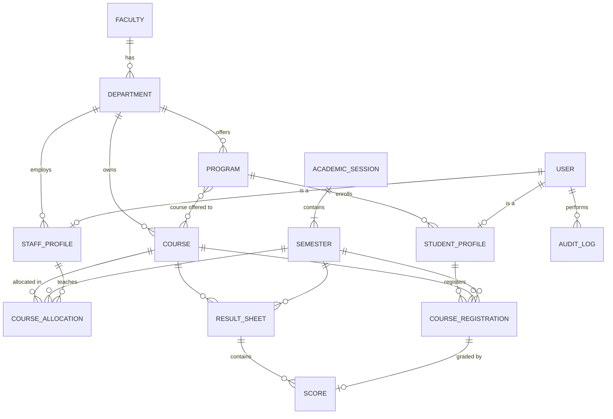

# Architecture

## 1. Overview

A single Django backend exposes a JSON API; a React single-page app consumes it.
The browser only ever talks to one origin: in development Vite proxies `/api` to Django,
and in production Vercel rewrites `/api` to the Render backend. That lets us use Django's
session cookies instead of tokens (see D2, D11).

```
Browser (React SPA)
   │  fetch /api/...  (session cookie + CSRF header)
   ▼
Django + DRF
   ├── views        thin: auth, parse, call service, serialize
   ├── permissions  role checks + object scoping
   ├── services     business rules, state transitions, audit logging
   └── models       constraints the database itself enforces
   ▼
SQLite (default) / PostgreSQL (via DATABASE_URL)
```

## 2. Stack

| Layer      | Choice                                    | Why |
|------------|-------------------------------------------|-----|
| Backend    | Django 5.2 LTS + Django REST Framework    | Mature auth, ORM, migrations, and admin out of the box. DRF gives serializers for validation and pluggable permission classes for RBAC. |
| Database   | SQLite by default, PostgreSQL supported   | Evaluators can run it with zero setup. Same ORM code runs on Postgres by setting `DATABASE_URL`. |
| Auth       | Django sessions (HttpOnly cookie) + CSRF  | See decision D2. |
| Frontend   | React + TypeScript + Vite                 | Fast dev server; types catch API-shape mistakes early. |
| Styling    | Tailwind CSS 4 + shadcn/ui, with a few beUI components | shadcn/ui covers the basics (table, form, dialog, sidebar); beUI adds animated touches through the same CLI. See D12. |
| Hosting    | Vercel (frontend), Render (backend + Postgres) | Free tiers, deploy from git, and one `render.yaml` creates both the API and the database. See D11. |
| Data fetch | TanStack Query + a small fetch wrapper    | Caching, loading/error states, and refetch-after-mutation without writing a store. |
| Routing    | React Router                              | Role-based route guards and nested dashboard layouts. |
| Tests      | pytest + pytest-django                    | Focused on permissions and workflow rules. |

## 3. Backend structure

One Django app per domain. Each app owns its models, serializers, views, and `services.py`.

| App            | Owns |
|----------------|------|
| `accounts`     | `User`, `StudentProfile`, `StaffProfile`; login/logout/me; user management |
| `academics`    | `Faculty`, `Department`, `Program`, `AcademicSession`, `Semester`, `Course`, `CourseAllocation` |
| `registration` | `CourseRegistration` and the eligibility rules |
| `results`      | `ResultSheet`, `Score`, grading scale, GPA/CGPA calculation, approval state machine |
| `audit`        | `AuditLog` and a single `record()` helper |
| `reports`      | Read-only aggregate endpoints for dashboards (no models) |
| `core`         | Shared permission classes, pagination, base exception handling |

## 4. Data model



### Key models

- **User** — custom user (email login). `role`: `STUDENT | LECTURER | DEPT_ADMIN | SUPER_ADMIN`.
  `status`: `ACTIVE | SUSPENDED | DEACTIVATED`; anything other than active sets `is_active=False`.
- **StudentProfile** — `user` (1:1), `matric_number` (unique), `program`, `level` (100–600).
  Department and faculty are derived through `program`, never stored twice.
- **StaffProfile** — `user` (1:1), `staff_id` (unique), `department`. Used by lecturers and
  department admins; the department here is what scopes everything they can see.
- **Program** — `department`, `name`, `code`, `duration_years` (bounds the valid levels).
- **AcademicSession** / **Semester** — `Semester(session, term=FIRST|SECOND, is_current,
  registration_open)`. A partial unique constraint guarantees at most one current semester.
- **Course** — `department` (owner), `code` (unique), `title`, `units`, `level`, `term`,
  `programs` (M2M: which programs may take it — allows shared courses like GST).
- **CourseAllocation** — `(course, semester) → lecturer`, unique per course per semester.
- **CourseRegistration** — `(student, course, semester)` with a unique constraint.
- **ResultSheet** — one per `(course, semester)`; carries the workflow `status`, submitter,
  reviewer, timestamps, and review comment.
- **Score** — `sheet`, `registration` (1:1), `ca_score`, `exam_score`, plus computed `total`,
  `grade`, `grade_point`. Scores can only exist for registered students.
- **AuditLog** — `actor`, `action`, `target_type`, `target_id`, `details` (JSON), `created_at`.
  Append-only; no update/delete endpoints.

### Constraints enforced by the database (not just the code)

- Unique: matric number, staff ID, course code, `(student, course, semester)`,
  `(course, semester)` allocation, `(course, semester)` result sheet, `(session, term)`.
- At most one `Semester` with `is_current=True`.
- Check constraints: `0 ≤ ca_score ≤ CA_MAX`, `0 ≤ exam_score ≤ EXAM_MAX`, `units > 0`.

## 5. Permission logic

Three layers, each answering a different question:

1. **Is this role allowed to call this endpoint?** — DRF permission classes
   (`IsStudent`, `IsLecturer`, `IsDeptAdmin`, `IsSuperAdmin`) on each view.
2. **Which records can this user see?** — every view's `get_queryset()` is filtered by scope:
   - Student → own records only
   - Lecturer → courses allocated to them in the given semester, and those courses' students
   - Dept admin → records whose department is their `StaffProfile.department`
   - Super admin → everything

   Out-of-scope objects return **404, not 403**, so the API doesn't reveal what exists.
3. **Is this action valid right now?** — service functions check business rules
   (eligibility, workflow state, "can't approve your own submission") and raise a
   validation error with a clear message.

The React app reads `role` from `/api/auth/me` and hides routes the user can't use,
but that is a convenience; removing it would not open any data.

## 6. Key workflows

### Course registration
`registration.services.register_courses(student, course_ids)` runs in a transaction and rejects
the request unless: the current semester exists and `registration_open` is true; each course's
`programs` includes the student's program; `course.level == student.level`;
`course.term == semester.term`; the student isn't already registered (also guaranteed by the
unique constraint). Optional: a maximum-units-per-semester setting.

### Result lifecycle

```
DRAFT ──submit──▶ SUBMITTED ──approve──▶ APPROVED
  ▲                   │
  └──── return ───────┘   (dept admin, comment required → status RETURNED, editable again)
```

- Lecturer edits scores only while the sheet is `DRAFT` or `RETURNED`.
- Submit requires a score for every registered student.
- Only a dept admin of the course's department can approve or return; the service also
  rejects the action if `reviewer == sheet.submitted_by`.
- Reopening an approved sheet is a dept-admin action that moves it back to `RETURNED`
  and is audited ("authorized reopening").
- Students only ever see scores whose sheet is `APPROVED` — enforced in the queryset.

All transitions go through one function with an explicit allowed-transitions table, and each
one writes an `AuditLog` entry.

## 7. Grading and GPA

Configured in `settings.GRADING` (documented here and in the README):

| Score  | Grade | Point |
|--------|-------|-------|
| 70–100 | A     | 5     |
| 60–69  | B     | 4     |
| 50–59  | C     | 3     |
| 45–49  | D     | 2     |
| 40–44  | E     | 1     |
| 0–39   | F     | 0     |

CA is out of 30, exam out of 70.
`GPA = Σ(units × grade_point) / Σ(units)` over a semester's approved scores;
CGPA is the same sum across all approved scores. GPA is computed on read rather than stored,
so it can never drift out of sync with the underlying scores.

## 8. Security summary

- Session cookie: `HttpOnly`, `SameSite=Lax`, `Secure` in production. CSRF token required on
  all unsafe methods.
- Django password hashing (PBKDF2) and password validators.
- Login endpoint throttled (DRF `ScopedRateThrottle`).
- Suspended/deactivated users have `is_active=False`; Django refuses both new logins and
  existing sessions for them, so suspension takes effect immediately.
- All input validated by serializers; score ranges and uniqueness also enforced in the DB.
- Every result submission, approval, return, reopen, role change, and account status change
  is written to the audit log.
- Secrets and `DEBUG` come from environment variables, never committed.

## 9. Deployment

```
browser ──▶ https://uemp.vercel.app            (React build, static)
              └─ /api/*  ──rewrite──▶ https://uemp-api.onrender.com/api/*   (Django + gunicorn)
                                              └─▶ Render PostgreSQL
```

- `frontend/vercel.json` rewrites `/api/:path*` to the Render URL, plus an SPA fallback to `index.html`.
- Django production settings: `CSRF_TRUSTED_ORIGINS` includes the Vercel URL,
  `SECURE_PROXY_SSL_HEADER` set, `SESSION_COOKIE_SECURE`/`CSRF_COOKIE_SECURE` on,
  static files via WhiteNoise.
- `render.yaml` (a Render Blueprint) creates the web service and a free Postgres database together
  and wires `DATABASE_URL` between them. The build step runs `migrate` and `seed_demo`.
- Render's free Postgres expires after 30 days, which is enough for an assessment review. SQLite isn't
  an option on Render because its disk is wiped on every restart.
- Render's free tier sleeps after 15 minutes idle, so the first request can take up to a minute.
  Open the backend's `/api/health/` before a demo.

## 10. Decisions

| #  | Decision | Reason | Rejected |
|----|----------|--------|----------|
| D1 | Monolith: one Django project, one React app | Small team, 24 h, one database. Splitting buys nothing here. | Microservices |
| D2 | Session auth over JWT | Same-origin SPA, so cookies work. HttpOnly cookie isn't readable by JS (XSS can't steal it); logout and suspension invalidate server-side instantly. Less code than refresh-token rotation. | JWT in localStorage |
| D3 | Four fixed roles as an enum on `User` | The brief defines four roles with fixed rules. A configurable permission matrix adds UI and complexity with no requirement behind it. | Django Groups/Permissions matrix |
| D4 | Separate `StudentProfile` / `StaffProfile` | Keeps `User` focused on auth; role-specific fields don't leave nullable columns everywhere. | Single wide user table |
| D5 | Approval at `ResultSheet` level, not per score | Departments approve a course's results as a batch; one status to track and audit. | Status on every score |
| D6 | Business rules in `services.py` | One place to read and test each rule; views and serializers stay thin. | Rules in signals / fat serializers |
| D7 | Explicit audit calls, not signals | Audit entries need the acting user and intent ("approved", "returned"), which signals don't know. Explicit calls are also easier to follow. | `post_save` signals, third-party audit packages |
| D8 | GPA computed on read | Avoids stale denormalized values; data volume is small. | Stored GPA fields |
| D9 | SQLite default, Postgres-ready | Zero-setup evaluation; nothing in the code is SQLite-specific. | Requiring Postgres/Docker to run |
| D10 | 404 for out-of-scope objects | Doesn't confirm existence of records the user can't access. | 403 |
| D11 | Vercel rewrites `/api/*` to Render, so the browser sees one origin | Session cookies stay first-party (`SameSite=Lax`) and no CORS config is needed. Mirrors the Vite proxy used in development, so dev and prod behave the same. | Cross-site cookies with `SameSite=None` + CORS (blocked by Safari and third-party-cookie restrictions); switching to JWT |
| D12 | Tailwind + shadcn/ui, with beUI for a few animated pieces | shadcn/ui provides the components an admin portal needs (data table, forms, dialog, sidebar) as code we own. beUI adds polish through the same CLI but has no tables or forms, so it can't be the base. | Mantine; beUI alone |
| D13 | Django admin site mounted only when `DEBUG` is on | Handy for inspecting data locally, but production access goes through the API so every action passes the same permission checks and audit log. | Exposing /admin/ in production |

## 11. Build plan

| Phase | Work | Est. |
|-------|------|------|
| 0 | Scaffold backend + frontend, git, lint/format config | 1 h |
| 1 | Models, migrations, constraints, `seed_demo` command | 3 h |
| 2 | Auth endpoints, permission classes, scoped viewsets, services | 5 h |
| 3 | Tests: permissions per role, registration rules, result transitions, GPA | 2 h |
| 4 | Frontend: login, layout, then student → lecturer → dept admin → super admin pages | 8 h |
| 5 | README, ER diagram export, test credentials, polish, error states | 2 h |
| 6 | Record demo | 1 h |

Order matters: backend workflows and tests first, so the UI is built against an API that is
already known to enforce the rules.
