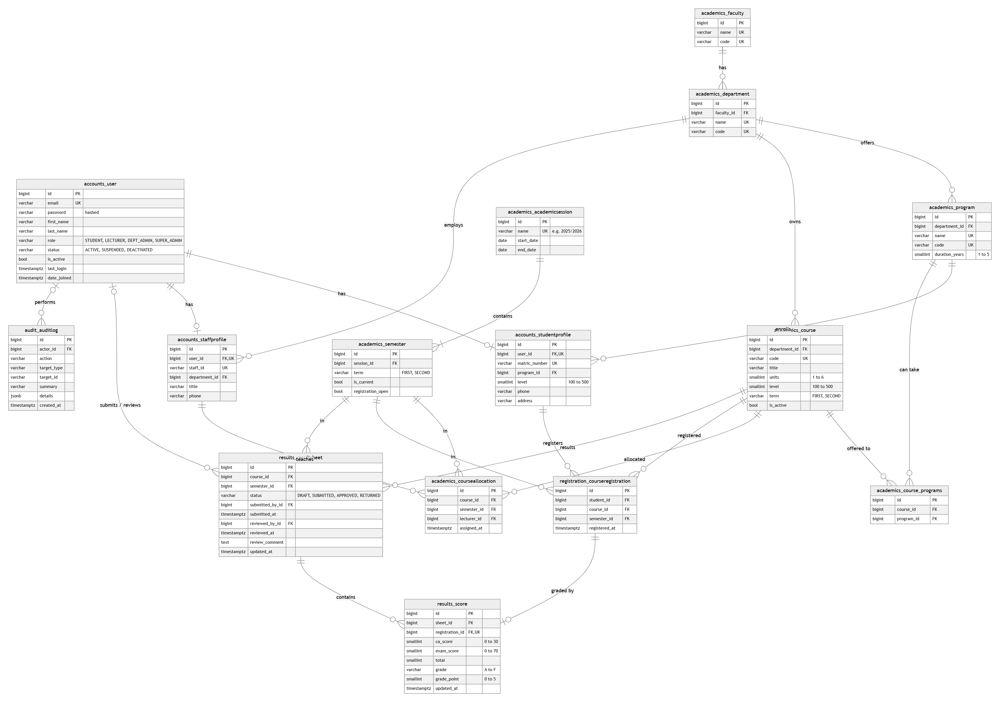

# Database schema and ER diagram

Types are the PostgreSQL column types. PK = primary key, FK = foreign key, UK = unique.
The crow's foot marks the "many" side of each relationship, and a circle means optional.

Click the diagram to open it full size.

## Relationships

| From | To | Cardinality | Meaning |
|---|---|---|---|
| `accounts_user` | `accounts_studentprofile` | 1 : 0..1 | A student account has one student profile. |
| `accounts_user` | `accounts_staffprofile` | 1 : 0..1 | A lecturer or department admin account has one staff profile. The super admin has neither profile. |
| `academics_faculty` | `academics_department` | 1 : many | Every department belongs to one faculty. |
| `academics_department` | `academics_program` | 1 : many | A department offers programs (e.g. B.Sc. Computer Science). |
| `academics_department` | `academics_course` | 1 : many | The department that owns a course is the one that manages it and approves its results. |
| `academics_department` | `accounts_staffprofile` | 1 : many | A staff member's department decides everything they can see and change. |
| `academics_program` | `accounts_studentprofile` | 1 : many | A student is enrolled in one program; their department and faculty come through it. |
| `academics_course` | `academics_program` | many : many | Through `academics_course_programs`. Which programs may register a course, so one course can serve several programs. |
| `academics_academicsession` | `academics_semester` | 1 : 1..2 | A session (2025/2026) has a first and a second semester. |
| `academics_course` + `academics_semester` | `academics_courseallocation` | 1 : 0..1 | Each course has at most one lecturer per semester. |
| `accounts_staffprofile` | `academics_courseallocation` | 1 : many | A lecturer can teach several courses. |
| `accounts_studentprofile` | `registration_courseregistration` | 1 : many | One row per course a student registers in a semester. |
| `academics_course` + `academics_semester` | `results_resultsheet` | 1 : 0..1 | One result sheet per course per semester; approval happens on the sheet. |
| `accounts_user` | `results_resultsheet` | 0..1 : many | `submitted_by` (the lecturer) and `reviewed_by` (the department admin). |
| `results_resultsheet` | `results_score` | 1 : many | The scores on a sheet. |
| `registration_courseregistration` | `results_score` | 1 : 0..1 | A score can only exist for a registered student, at most once. |
| `accounts_user` | `audit_auditlog` | 0..1 : many | Who performed each logged action. |

## Tables

Every table has `id bigint` as its primary key, which is left out of the lists below.

### accounts_user

Login accounts for all four roles. Users sign in with their email.

| Column | Type | Null | Notes |
|---|---|---|---|
| `email` | varchar(254) | no | Unique. The login name. |
| `password` | varchar(128) | no | Salted hash (PBKDF2), never the password itself. |
| `first_name` | varchar(150) | no | |
| `last_name` | varchar(150) | no | |
| `role` | varchar(20) | no | `STUDENT`, `LECTURER`, `DEPT_ADMIN` or `SUPER_ADMIN`. |
| `status` | varchar(20) | no | `ACTIVE` (default), `SUSPENDED` or `DEACTIVATED`. |
| `is_active` | boolean | no | Kept in step with `status`; false blocks sign-in and ends existing sessions. |
| `is_staff`, `is_superuser` | boolean | no | Django's own flags, only used for the development admin site. |
| `last_login` | timestamptz | yes | |
| `date_joined` | timestamptz | no | |

### accounts_studentprofile

| Column | Type | Null | Notes |
|---|---|---|---|
| `user_id` | bigint | no | FK → `accounts_user`, unique (one profile per user). |
| `matric_number` | varchar(30) | no | Unique, e.g. `CSC/2024/001`. |
| `program_id` | bigint | no | FK → `academics_program`. |
| `level` | smallint | no | 100, 200, 300, 400 or 500, and no higher than the program's duration allows. |
| `phone` | varchar(20) | no | Editable by the student. |
| `address` | varchar(255) | no | Editable by the student. |

### accounts_staffprofile

| Column | Type | Null | Notes |
|---|---|---|---|
| `user_id` | bigint | no | FK → `accounts_user`, unique. |
| `staff_id` | varchar(30) | no | Unique. |
| `department_id` | bigint | no | FK → `academics_department`. |
| `title` | varchar(30) | no | e.g. Dr., Prof. |
| `phone` | varchar(20) | no | |

### academics_faculty

| Column | Type | Null | Notes |
|---|---|---|---|
| `name` | varchar(150) | no | Unique. |
| `code` | varchar(10) | no | Unique, e.g. `SCI`. |

### academics_department

| Column | Type | Null | Notes |
|---|---|---|---|
| `faculty_id` | bigint | no | FK → `academics_faculty`. |
| `name` | varchar(150) | no | Unique. |
| `code` | varchar(10) | no | Unique, e.g. `CSC`. |

### academics_program

| Column | Type | Null | Notes |
|---|---|---|---|
| `department_id` | bigint | no | FK → `academics_department`. |
| `name` | varchar(150) | no | Unique. |
| `code` | varchar(20) | no | Unique. |
| `duration_years` | smallint | no | 1 to 5, default 4. Sets the highest level a student can reach. |

### academics_academicsession

| Column | Type | Null | Notes |
|---|---|---|---|
| `name` | varchar(20) | no | Unique, e.g. `2025/2026`. |
| `start_date` | date | no | |
| `end_date` | date | no | Must be after `start_date`. |

### academics_semester

| Column | Type | Null | Notes |
|---|---|---|---|
| `session_id` | bigint | no | FK → `academics_academicsession`. |
| `term` | varchar(10) | no | `FIRST` or `SECOND`; unique within a session. |
| `is_current` | boolean | no | Only one semester in the whole table can be current. |
| `registration_open` | boolean | no | Students can register only while this is true. |

### academics_course

| Column | Type | Null | Notes |
|---|---|---|---|
| `department_id` | bigint | no | FK → `academics_department`, the owning department. |
| `code` | varchar(10) | no | Unique, e.g. `CSC201`. |
| `title` | varchar(200) | no | |
| `units` | smallint | no | 1 to 6. |
| `level` | smallint | no | The level it is taken at, 100 to 500. |
| `term` | varchar(10) | no | `FIRST` or `SECOND`, the semester it runs in. |
| `is_active` | boolean | no | Inactive courses can't be registered. |

### academics_course_programs

Join table for the course ↔ program many-to-many.

| Column | Type | Null | Notes |
|---|---|---|---|
| `course_id` | bigint | no | FK → `academics_course`. |
| `program_id` | bigint | no | FK → `academics_program`. The pair is unique. |

### academics_courseallocation

| Column | Type | Null | Notes |
|---|---|---|---|
| `course_id` | bigint | no | FK → `academics_course`. |
| `semester_id` | bigint | no | FK → `academics_semester`. |
| `lecturer_id` | bigint | no | FK → `accounts_staffprofile`. |
| `assigned_at` | timestamptz | no | |

### registration_courseregistration

| Column | Type | Null | Notes |
|---|---|---|---|
| `student_id` | bigint | no | FK → `accounts_studentprofile`. |
| `course_id` | bigint | no | FK → `academics_course`. |
| `semester_id` | bigint | no | FK → `academics_semester`. |
| `registered_at` | timestamptz | no | |

### results_resultsheet

| Column | Type | Null | Notes |
|---|---|---|---|
| `course_id` | bigint | no | FK → `academics_course`. |
| `semester_id` | bigint | no | FK → `academics_semester`. |
| `status` | varchar(10) | no | `DRAFT` → `SUBMITTED` → `APPROVED`, or back to `RETURNED`. |
| `submitted_by_id` | bigint | yes | FK → `accounts_user`, the lecturer who submitted. |
| `submitted_at` | timestamptz | yes | |
| `reviewed_by_id` | bigint | yes | FK → `accounts_user`, the department admin who approved or returned it. |
| `reviewed_at` | timestamptz | yes | |
| `review_comment` | text | no | Required when results are returned. |
| `updated_at` | timestamptz | no | |

### results_score

| Column | Type | Null | Notes |
|---|---|---|---|
| `sheet_id` | bigint | no | FK → `results_resultsheet`. |
| `registration_id` | bigint | no | FK → `registration_courseregistration`, unique. |
| `ca_score` | smallint | yes | 0 to 30. Blank while the sheet is a draft. |
| `exam_score` | smallint | yes | 0 to 70. |
| `total` | smallint | yes | `ca_score + exam_score`, set on save. |
| `grade` | varchar(2) | no | A to F from the grading scale. |
| `grade_point` | smallint | yes | 5 to 0. |
| `updated_at` | timestamptz | no | |

GPA and CGPA are not stored. They are calculated from `grade_point` and course `units` when
read, so they can never go stale.

### audit_auditlog

Append-only: the API has no way to edit or delete entries.

| Column | Type | Null | Notes |
|---|---|---|---|
| `actor_id` | bigint | yes | FK → `accounts_user`. Kept as null if the user is ever removed, so the entry survives. |
| `action` | varchar(50) | no | Indexed, e.g. `result.submitted`, `result.scores_saved`. |
| `target_type` | varchar(50) | no | e.g. `ResultSheet`. |
| `target_id` | varchar(50) | no | |
| `summary` | varchar(255) | no | A readable line for the audit log screen. |
| `details` | jsonb | no | Extra data, such as before/after values of changed scores. |
| `created_at` | timestamptz | no | Indexed. |

## Constraints

Enforced by the database itself, so they hold even if application code has a bug.

| Table | Constraint | Rule |
|---|---|---|
| `accounts_user` | unique | `email` |
| `accounts_studentprofile` | unique | `user_id`, `matric_number` |
| `accounts_staffprofile` | unique | `user_id`, `staff_id` |
| `academics_faculty`, `academics_department` | unique | `name`, `code` |
| `academics_program` | unique | `name`, `code` |
| `academics_program` | `program_duration_between_1_and_5` | `1 <= duration_years <= 5` |
| `academics_academicsession` | unique | `name` |
| `academics_academicsession` | `session_ends_after_it_starts` | `end_date > start_date` |
| `academics_semester` | `unique_term_per_session` | `(session_id, term)` unique |
| `academics_semester` | `single_current_semester` | Partial unique index on `is_current WHERE is_current = true`: at most one current semester |
| `academics_course` | unique | `code` |
| `academics_course` | `course_units_between_1_and_6` | `1 <= units <= 6` |
| `academics_courseallocation` | `one_lecturer_per_course_per_semester` | `(course_id, semester_id)` unique |
| `registration_courseregistration` | `no_duplicate_registration` | `(student_id, course_id, semester_id)` unique |
| `results_resultsheet` | `one_result_sheet_per_course_per_semester` | `(course_id, semester_id)` unique |
| `results_score` | unique | `registration_id` |
| `results_score` | `ca_score_within_max` | `ca_score <= 30` |
| `results_score` | `exam_score_within_max` | `exam_score <= 70` |
| all `smallint` score, level and unit columns | check | `>= 0` |

Rules that need more than one table (a student only registering courses for their own program
and level, the 24-unit limit, a lecturer only scoring their allocated course) are enforced in
the service layer, described in [ARCHITECTURE.md](ARCHITECTURE.md#5-permission-logic).

## Delete behaviour

Academic records are never deleted out from under each other.

| Foreign key | On delete | Why |
|---|---|---|
| Everything pointing at faculties, departments, programs, sessions, semesters, courses, profiles and registrations | `PROTECT` | A course with registrations, or a department with students, can't be deleted. The API returns 409 and the record has to be deactivated instead. |
| `results_resultsheet.submitted_by_id`, `reviewed_by_id` | `PROTECT` | Who submitted and approved results must stay on record. |
| `accounts_*profile.user_id` | `CASCADE` | A profile has no meaning without its account. Accounts are deactivated, not deleted, in practice. |
| `results_score.sheet_id` | `CASCADE` | Scores belong to their sheet. |
| `audit_auditlog.actor_id` | `SET NULL` | The log entry outlives the account that made it. |
